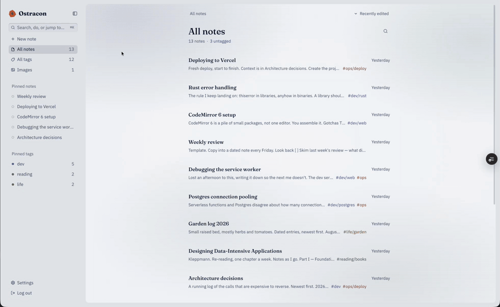

#  &nbsp;Ostracon
[](https://github.com/schmitt-steven/Ostracon/releases)
[](https://nextjs.org)
[](LICENSE)


Ostracon is a tag-based Markdown notes app for one person.

It runs on Next.js and hosting is free: one Vercel project holds the app, a Neon Postgres database, and a Blob store for images. All three have generous free tiers. You can also [host it yourself with Docker](#self-hosting-with-docker).



## Some Features

- **Markdown editor**: CodeMirror 6 (what Obsidian uses), write/preview/split-view toggle, Shiki syntax highlighting.
- **Tag-based organization**: hierarchical tags and filtering.
- **All-in-one menu**: `⌘+K` / `Ctrl+K` for search, navigation, and context-aware actions. No mouse? No problem.
- **Installable**: add it to your home screen or dock and it opens in its own window, with shortcuts and a share target. Open `.md` and `.txt` files directly in Ostracon. If you lose connection mid-work your edits are saved once you're back online.
- **Full-text search**: instant and client-side over the whole corpus.
- **Dark mode**: switch from settings or the menu.
- **Images**: paste or drag-and-drop to upload; gallery browser with all uploaded images. Images are private: only visible when signed in.
- **AI Integration**: select text and Explain, Summarize, Rewrite, or Ask, via Gemini or local LLMs.
- **Authentication**: signed sessions, per-device tracking, login throttling.
- **Import / Export**: Import `.md` and `.txt` files, or a `.zip`. Export everything as a `.zip`.
- **Update notice**: tells you when a new version is out and how to migrate to it.

## Getting started

You deploy Ostracon to your own Vercel project. Everything it needs (hosting, database, image storage) lives inside that single project. Follow these steps to get it running:

### 1. Fork this repo (or clone it and push to a new private repo of your own).

### 2. Create the Vercel project

In the Vercel dashboard, go to **Add New → Project**, and import your newly forked repo.

### 3. Add the database and image storage

In the project's **Storage** tab, select **Create Database → Neon (Serverless Postgres)**, pick your preferred region, give your DB a name and create it. Vercel connects it to the project automatically.

Still under **Storage**, select **Create Database → Blob (Fast Object Storage)**. Give the blob store a name, pick the region you want, and set its access to **Private**, then create it. Ostracon serves every image itself, and only to a signed-in browser, so the store must be private.

### 4. Set the required secrets

In the project's **Environment Variables** tab, add:

| Variable | Value |
| --- | --- |
| `APP_PASSWORD` | The password you'll sign in with the first time. |
| `SESSION_SECRET` | A generated random string. Run `openssl rand -base64 32` and paste the output. |

Mark both as a **Secret** when creating them in Vercel. `SESSION_SECRET` signs your login
cookie. If you don't have `openssl`, you could use
`node -e "console.log(require('crypto').randomBytes(32).toString('base64'))"`.

Optionally add your `GEMINI_API_KEY` to enable the AI features.

### 5. Deploy the app

Go to the **Deployments** tab.
If Vercel already tried to deploy, click the three dots of the last deployment and redeploy.
Otherwise click the three dots in the top right corner and start a new deployment.

Once Vercel finished the deployment you can open your website and unlock Ostracon with your `APP_PASSWORD`. If you want a different password, you can change it in Ostracon's settings. Once you have, you can also delete the `APP_PASSWORD` environment variable.

## Updating

Ostracon tells you when a new release is available. An update button will appear in the side bar. Click it and follow the instructions to update.

## Self-hosting with Docker

Instead of Vercel, you can run Ostracon on your own machine or server. Docker Compose starts two containers, the app and a Postgres database, and images are stored on disk instead of in a Blob store. You need [Docker](https://docs.docker.com/get-docker/) with Compose. Source code not needed, you can download the image from GitHub's container registry, for both Intel/AMD and ARM machines.

### 1. Download the compose file and the settings

In an empty folder, run:

```bash
curl -O https://raw.githubusercontent.com/schmitt-steven/Ostracon/main/docker-compose.yml
curl -o .env https://raw.githubusercontent.com/schmitt-steven/Ostracon/main/.env.docker.example
```

### 2. Fill in the curled `.env` file

| Variable | Value |
| --- | --- |
| `POSTGRES_PASSWORD` | Password for the bundled database. Letters and digits only. |
| `APP_PASSWORD` | The password you'll sign in with the first time. |
| `SESSION_SECRET` | A generated random string. You could run `openssl rand -hex 32` for this. |

The `.env` file also explains all optional settings.

### 3. Run the image

```bash
docker compose up -d
```

Open `http://localhost:3000`, or your server's address, and unlock Ostracon with your `APP_PASSWORD`. The first start downloads the images and sets up the database, which can take a while.

### Updating

You'll see an update notice when a new release is out. To update, run:

```bash
docker compose pull
docker compose up -d
```

Notes and images live in Docker volumes, so they are kept after updates and `docker compose down`. Only `docker compose down -v` deletes them.

### Backups

Run these in the folder with `docker-compose.yml` to back up the database and the uploaded images:

```bash
docker compose exec -T db pg_dump -U postgres postgres > ostracon.sql
docker compose exec -T app tar czf - -C /data uploads > uploads.tar.gz
```

To restore, run the same commands the other way round on a fresh install: `psql -U postgres postgres < ostracon.sql` and `tar xzf - -C /data < uploads.tar.gz`.

### HTTPS

If Ostracon is reachable from the internet, put it behind a reverse proxy with HTTPS, such as [Caddy](https://caddyserver.com). See `COOKIE_SECURE` in `.env`.

## Running Ostracon locally

```bash
npm install
npm install -g vercel        # Vercel CLI
vercel link                  # and pick the project you created above
vercel env pull .env.local   # fetches DATABASE_URL and the rest
npm run dev
```

LM Studio and Ollama are reachable in this mode and with Docker, but not on Vercel. Override `LMSTUDIO_BASE_URL` / `OLLAMA_BASE_URL` if the defaults shouldn't fit.
